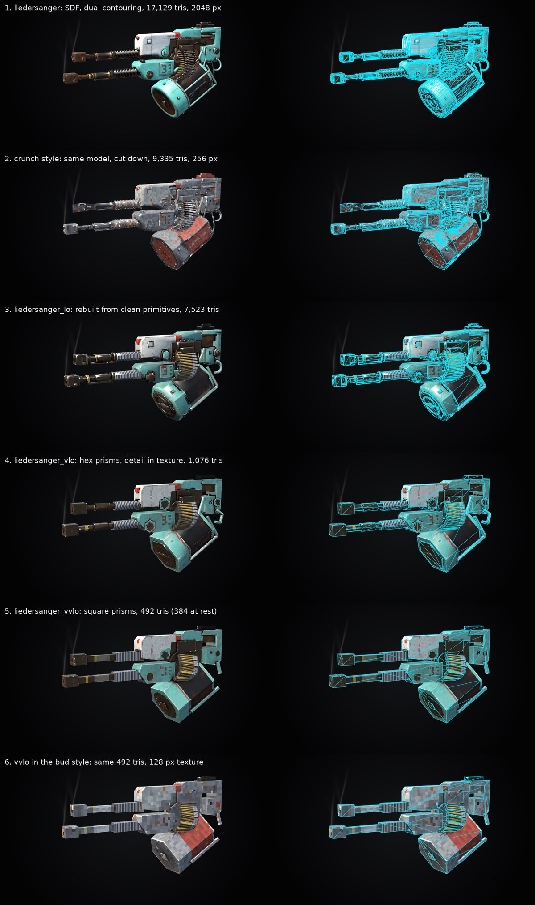
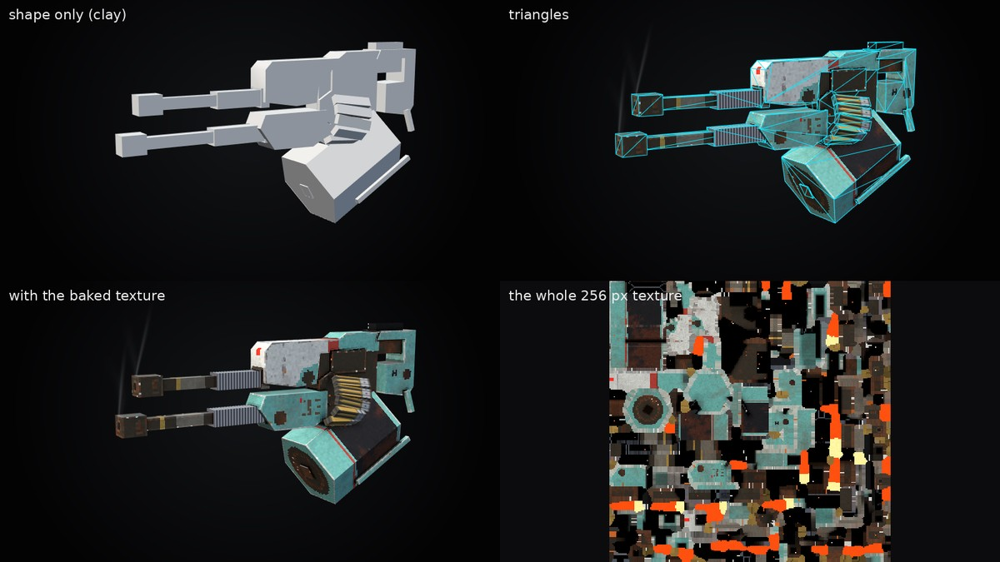
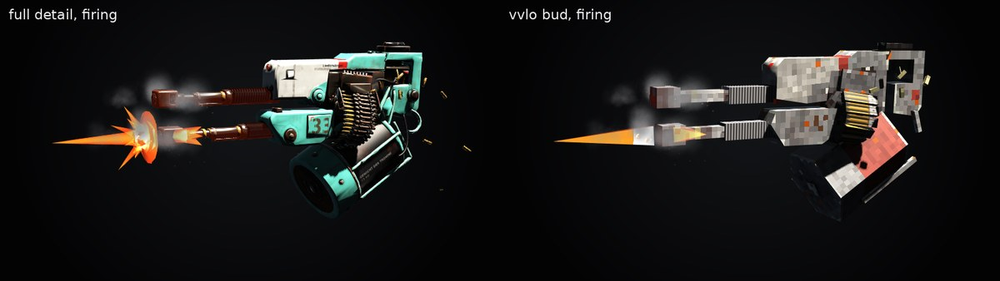
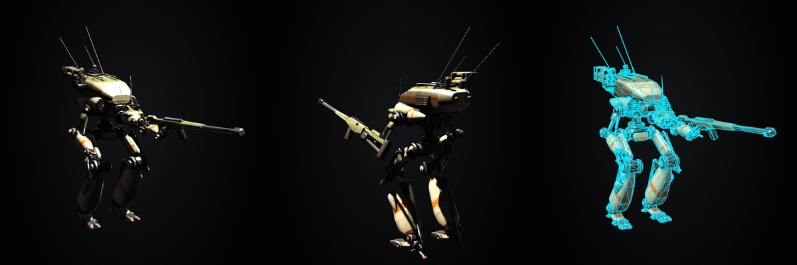

# How the gun and the robot were made

This is the story of the two models in this repo, in the order things happened: the
**Liedersanger** (a twin-barrel heavy machine gun with a hanging ammo drum) and **Scoobee**
(a two-legged walker inspired by the mechs in Phantom Crash). The lowest-poly gun,
`liedersanger_vvlo`, is the one to study. It only makes sense once you've seen the bigger
versions it was cut down from, so this starts at the beginning.



## Who did what

The work was a loop between a person and an AI coding agent (Claude, in Claude Code):

1. The person picked the reference pictures and the target look, and judged every result.
2. The agent wrote all the code, and wrote each model by hand as a Python program, looking at
   the reference picture and estimating sizes from its pixels.
3. The agent rendered the model with no window on screen (a headless GPU render to a PNG or
   MP4) and looked at the picture itself.
4. The person (and a brother, and later a friend) watched the renders and the live viewer and
   gave notes like "too toy-like", "the drum looks rusty", "this part floats", "recoil is
   bouncy". The agent changed the code and rebuilt.

Nothing is traced or captured from the reference images. They only guide proportions and
layout, and they aren't in this repo (`ref/` is gitignored because the art belongs to its
authors).

Everything else comes from code: shapes, textures, animation, sound mixing. Re-running the
build always produces the same model.

## The pipeline in one picture

```
gen/models/<name>.py          shapes, written as code (signed distance fields)
        |
        v
mesher                        shapes -> triangles
  - dual contouring + decimation   (full-detail version)
  - polys.py, artist-style polygons (low-poly versions)
        |
        v
UVs (xatlas) + texture bake   every texel coloured by asking the full-detail shape:
                              material, edge wear, grime, occlusion, rust, decals,
                              plus "texture-only" detail the mesh doesn't have
        |
        v
out/<name>/<name>.obj/.mtl/.png + .rig.sexp (which part moves about which joint)
        |
        v
viewer (C++/OpenGL)           plays gen/models/<name>.anim.sexp (motion, smoke)
                              and <name>.sound.sexp (sound), all as functions of time
```

### What an SDF is, and why we used one

An SDF (signed distance field) is a function: give it a point in space and it tells you how
far that point is from the surface (negative means inside). Boxes, cylinders, cones, tori
and extruded 2D outlines are each a few lines of maths. You combine them with unions
(optionally smooth, so they blend), cuts, repeats, bends and sweeps along curves. A gun
written this way looks like:

```python
tube  = Cylinder(0.28, half_length, GUNMETAL).at(x, 0, 0)
brake = Box(0.6, 0.48, 0.46, GUNMETAL).at(muzzle_x + 0.55, 0, 0)
barrel = Union(tube, nut, brake)
```

The big win is that the SDF also serves as the "high-poly" source for the texture. To
paint a texel the bake asks the SDF about that point: how close it is to an edge (worn
paint), how far into a crease (grime), how enclosed (ambient occlusion). Detail the mesh
never received still shows up in the texture. That is the trick behind the very low
versions.

The SDF code is in `gen/sdf.py`, meshing in `gen/meshing.py` and `gen/polys.py`, baking in
`gen/bake.py`, and the build driver in `gen/build.py`.

## Step by step: the gun

### 1. Full detail (`liedersanger`, 17,129 triangles, 2048 px texture)

The first model, `gen/models/liedersanger.py`, is about 400 lines of SDF pieces built from
the reference picture: barrels with recoil springs, muzzle brakes, the housings, a feed gear,
a belt of rounds running from the drum up into the gun, and spent cases.

- Each piece is meshed on its own by dual contouring, which keeps sharp creases and flat
  panels. It is then decimated (simplified) to its own triangle budget.
- Repeated parts (spring coils, belt links, bolts) are meshed once and copied.
- Normals come from the SDF's gradient, so curves shade round and only real creases look
  sharp.
- The texture bake adds paint wear on edges, grime in corners, rust patches, and decals (the
  "33", stencils).

At this stage we also built the rig, the animation and the sound (more on those below).
The `first-good-model` and `finalgun` tags mark this period.

### 2. A style experiment that didn't land (`crunch`, 9,335 triangles)

Styles are small sexp files in `gen/styles/` that change how the same model is built: how
many sides round things get, how coarse the meshing is, the texture size, flat or smooth
shading, how much speckle/chips/rust to paint, and a colour palette. `crunch` was a chunky
late-90s console look made from the same full model.

Verdict: it read as toy-like. Decimating a dense surface down that far also produces
"needles" (long thin sliver triangles). Lessons kept for everything after:

- Speckle noise and white chips look like a toy. Soft grime, occlusion and streaky rust
  look like a real machine.
- Nearest-neighbour texels are the right look. The chunky pixels are a feature.
- No needle triangles. Low poly should look like an artist made it.

### 3. Rebuilt from clean primitives (`liedersanger_lo`, 7,523 triangles, 256 px)

Rather than squash the full model, the gun was rewritten for low fidelity in
`gen/models/liedersanger_lo.py`, with the same layout and the same part names (so the same
animation, smoke and sound drive it). Parts were resized to read at a distance: thick
barrels, a handful of fat coil rings, big brakes, chunky links, nothing hairline.

That rewrite came with a new mesher, `gen/polys.py`. It walks the SDF tree and turns each
primitive into the polygons a modeller would make: chamfered boxes, n-sided prisms with
bevelled ends, extruded profiles, lofts, low tori. Shapes that touch just overlap; there is
no boolean surgery, so no slivers. The style for this is `lofi`. Fine repeated detail moved
into **tile textures**: the coil fins and the belt's rounds are small repeating textures,
and the coil tile scrolls as the barrel recoils, so the spring looks like it compresses.

The person called this look "low-poly realism", and it became the direction.

### 4. A strict budget (`liedersanger_vlo`, 1,076 triangles)

The next question: how far down can it go and still read as the same gun? `vlo` rebuilds the
lo gun from plain parts. Every round part is a hexagonal prism with no chamfers, and every
block is a plain box. Everything the lo version modelled as geometry (gear teeth, cover ribs,
drum bolts and rings, the coil, the belt rounds, panel seams) is now carved or painted into
the texture instead.

Two tools came out of this, so the reduction could be measured instead of eyeballed:

- `gen/build.py --reduce MM` drops faces that are hidden inside other parts, then simplifies
  wherever the result stays within MM millimetres of the true surface.
- `tools/lookalike.py a.obj b.obj` renders two builds from six cameras as untextured clay
  and reports how much the silhouette and shading changed. It compares clay because the UV
  layout changes between builds, so comparing textured images mostly measures where texels
  landed.

### 5. The barest budget (`liedersanger_vvlo`, 492 triangles, 384 visible at rest)



`gen/models/liedersanger_vvlo.py` is about 160 lines and is the one worth reading in full.
The rules it follows:

1. **The geometry is just the silhouette.** Barrels are square-section prisms (the `vvlo`
   style sets `facets 4`, so every cylinder becomes four-sided). Housings are single
   extruded outlines (a `Prism` of a 2D polygon). The core is one block, and the drum is a
   hexagonal can.
2. **Every piece has a triangle budget**: `tris=36` for a barrel, `tris=12` for a cover,
   `tris=20` for a muzzle flash. The mesher emits plain polygons that stay inside it.
3. **Detail is declared on the piece but goes only into the texture.** Each `Piece` has
   `.paint(region, material)` and `.cut(shape, material)`. They don't change the mesh at
   all. They only change the SDF the bake reads:
   ```python
   pc.paint(Box(0.7, 1.0, 1.0, GUNMETAL).at(spring_x0 - 1.2, y, z), STEEL)  # the jacket, painted
   pc.cut(Box(0.16, 0.28, 0.7, GUNMETAL).at(port, y, z), GUNMETAL)         # the ejection port, carved
   gear.cut(Box(0.06, 0.06, 0.3, GUNMETAL)...)                              # nine gear teeth
   ```
   A cut makes the bake see a real groove, so it gets the dark edge and occlusion of a groove,
   while the mesh stays flat. Paint regions place the colour bands (the teal boss, the red
   stripe, the drum's face plate).
4. **Round things that must look round** get round paint: `disc()` paints a circle with a
   capsule shape, so it stays a circle whatever the facet count.
5. **Repeats get cheaper.** Belt links are double length with two rounds painted on each
   (the `rounds` tile), so half as many links move. Six spent cases cycle (the full gun has sixteen).
6. **Same part names as every other version**: `upper_barrel`, `drum`, `gear`, `belt.0`... So
   the one animation file, the smoke and the sound all drive this gun unchanged.
7. **A small texture with nearest filtering**: 256 px for the whole gun.

Build it:

```
.venv/bin/python gen/build.py liedersanger_vvlo
.venv/bin/python gen/build.py liedersanger_vvlo --style bud
```

### 6. The grey "bud" version (same 492 triangles, 128 px)

`gen/styles/bud.sexp` is the vvlo gun repainted for a friend's game look: mottled greys,
white edge chips, orange rust flecks, a brick-red drum, a 128 px texture. It is a style, not
a new model: the file is 22 lines of palette and weathering numbers. That shows the split:
the shape lives in the model, the look lives in the style.



## Animation, smoke and sound (shared by every gun version)

`gen/models/liedersanger.anim.sexp` describes the firing as data, and the viewer plays it.
Everything is a pure function of time, so live playback, scrubbing and video export always
match.

- A **fire-rate curve** decides when shots happen: wind up to 8 rounds/s, then wind down.
- **Tracks** run per shot: the barrels `kick` back in turn (top, then bottom), the gear
  `step`s, the belt `feed`s one link, spent cases are `throw`n with gravity and spin. The
  drum swings, the lamp glows.
- **Realism notes that changed the numbers:** recoil is a long fast kick, braking, then a
  *critically damped* return (no springy overshoot), and the whole gun moves straight back.
  Bouncy read as cartoon.
- **Smoke and sparks** (`wisp`, `puff`, `spark`) come out of the muzzles and ports. Every
  version keeps those in the same places, so the same emitters fit them all. (Scoobee's
  lights and exhausts instead come from marker points the model exports.)
- **Sound**: `liedersanger.sound.sexp` lists samples (cut, filtered, faded, given some
  room), and cues fire on the same events as the motion. The samples are free recordings
  found through the Openverse API (api.openverse.org, mostly freesound.org). They aren't in
  the repo; see [docs/sound-credits.md](docs/sound-credits.md).

## The robot: Scoobee



Scoobee came after the gun and pushed the system from "one object with moving bits" to "a
machine made of parts that plug together". It is still full detail (about 24,000 triangles,
2048 px, `mech` style). It has not been through a vvlo pass.

### Built as separate parts

- Every part (torso, head, pelvis, thigh, shin, foot, toes, arms, claws, rifle, flaps,
  launcher) is its own SDF model in `gen/models/scoobee/body.py` and `limbs.py`. Each sits
  in its own frame, with the joint it hangs from at the origin. The bodywork uses lofts
  (shapes stretched between cross-sections) for the sleek teardrop panels the person asked
  for ("2002 Corolla futurism", lanky, not a tin can).
- **Joints are defined once and shape both sides** (`gen/mech.py`). A knee is a hinge of a
  given radius and width. The thigh gets the housing, and the shin gets the knuckle that sits
  inside it. Turning the shin about the joint keeps the knuckle in the housing, so the leg
  stays one continuous machine at any angle.
- `gen/models/scoobee/assembly.sexp` plugs the parts together: which part goes on which
  socket, the rest pose (knees bent, hunched forward), and mirroring for the left side. It
  also places **rams**, hydraulic cylinders across the joints (knee, ankle, elbow). The
  cylinder rides one part and the rod the next, and the rod slides in and out as the joint
  turns.
- The build stands it on the ground (feet at y = 0) and bakes one texture for the whole mech.

### Made to walk

The walking isn't keyframed. It is computed in the viewer (`viewer/src/gait.cpp`):

- A speed curve drives a gait that blends from a walk, through a jog, to a sprint and an
  "all-out" sprint.
- Feet in contact with the ground are **planted** (they don't slide). Swing feet travel on
  smooth arcs with toe-off and heel strike. Two-bone IK bends the leg so the foot lands where
  it should.
- The body is driven by forces (braking early in each step, shoving late), so it bobs, sways
  and leans naturally. Each footfall sends an impact up the body.
- The rifle arm holds the gun steady against the body's motion. The rifle is carried muzzle
  down while moving and comes up at rest.
- It is all simulated once at load into tables, so it is a function of time like the gun's
  animation.

### Keeping it honest

Moving parts love to pass through each other. Three tools check that:

- `tools/overlap.py scoobee` poses the mech through the whole animation and reports any part
  that goes into another (a part and its parent are allowed to meet at their joint).
- `tools/floating.py scoobee` finds pieces of a part that touch nothing ("floating
  greebles").
- `tools/declip.py scoobee` hill-climbs the rest pose angles until clipping stops, and
  writes the result into a marked block of the anim file.

## Things we learned that apply beyond this repo

1. Write the model as code and keep the full-detail shape around. Every lower version and
   every texture can be derived from it.
2. At low budgets, artist-style primitives beat simplifying a dense mesh. Simplifying
   leaves needles.
3. Put the triangles into the silhouette and the detail into the texture. Carving detail into
   the shape the bake reads gives grooves real shading for free.
4. Keep part names identical across versions so one animation, one sound bank and one set of
   effects drive them all.
5. Realism comes from weathering (grime, occlusion, streaky rust) and from motion that
   settles without bouncing, not from noise.
6. A known weakness: the automatic UV unwrap (xatlas) cuts the model into many small islands.
   That's fine for a baked texture, but a runtime shader that works in UV space (scrolling
   patterns, camo) will show seams. Use object-space or triplanar effects, or give
   primitives their own simple UVs.

## Try it

See [README.md](README.md) for setup. In short: build a model with `gen/build.py`, view it
with the viewer, and render shots or videos with `scripts/shot.sh` and `scripts/anim.sh`.
